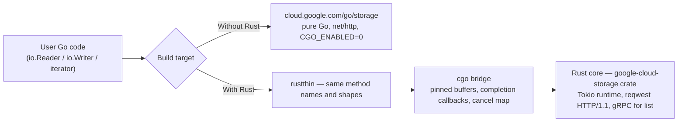

# Shared Rust Core under the Go GCS SDK — POC, Blockers, User Impact, Benchmarks

## 1. Purpose

The consolidation plan ([worklog](https://docs.google.com/document/d/1pC4PXbBVeXu9xIGn2E3D-Qkd8n87IqUsi8NUYtIXVdE/edit?resourcekey=0-4Uk_EjuRwyGBl76qHPbFuA&tab=t.0#heading=h.yokmyyo3vmmw)) is to write the storage logic once, in Rust, and have every language SDK be a thin wrapper around it. This document answers that for **Go** (`cloud.google.com/go/storage`):

1. How a thin‑Go / thick‑Rust client can be built — §2.
2. For each technical challenge: is it a hard blocker or high effort, and what would Go users lose that cannot be fixed because of how Go and Rust work — §3.
3. Benchmark numbers for the same user code with and without Rust — §4; how to reproduce — §5.

Scope: JSON reads, writes and object listing. The gRPC/[DirectPath](https://cloud.google.com/storage/docs/enable-grpc-api) path is excluded because the Rust core does not support DirectPath yet, so a comparison would be unfair.

Terms used below:
- **cgo** — Go's built‑in way of calling C code; it is also the only way Go can call Rust ([docs](https://pkg.go.dev/cmd/cgo)). Programs that use cgo need a C compiler at build time and link against the system C library.
- **`CGO_ENABLED=0`** — the setting that turns cgo off, giving a fully static Go binary that can be cross‑compiled for any OS/CPU from one machine ([docs](https://pkg.go.dev/cmd/cgo#hdr-Using_cgo_with_the_go_command)). Most open‑source users of the Go SDK build this way.
- **FFI** — "foreign function interface": a call that crosses from one language into another.

## 2. How the POC is built



Three layers, all in [`storage/internal/rust-poc`](file:///usr/local/google/home/cpriti/thickthin_go_rust_poc):

**(a) Rust core with a C interface** — [lib.rs](./gcs_core/src/lib.rs), [stream.rs](./gcs_core/src/stream.rs), ~800 lines on top of the unmodified [`google-cloud-storage` 1.20 crate](https://crates.io/crates/google-cloud-storage), compiled to a static library (`libgcs_core.a`).
- One process‑wide [Tokio](https://tokio.rs) async runtime (Rust's equivalent of the Go scheduler).
- Every entry point catches Rust panics — letting a panic escape into C is [undefined behaviour](https://doc.rust-lang.org/nomicon/ffi.html#ffi-and-unwinding).
- Streaming handles (`reader_open/read/close`, `writer_open/write/close`, `list_page`) so Go can present the real `storage` API instead of whole‑object calls.
- **Async bridge:** each call hands the work to Tokio and returns at once; Tokio calls back into Go when done. An op‑id → abort‑handle map implements cancellation.
- Errors travel as `(code, HTTP status, message)`.

**(b) Thin Go wrapper** — [gcsrust](./gothin/gcsrust) (the cgo bindings) and [rustthin](./gothin/rustthin/rustthin.go) (the `storage`‑shaped API, reusing `storage.Query`, `storage.ObjectAttrs`, `storage.Conditions`, [`storage.ErrObjectNotExist`](https://pkg.go.dev/cloud.google.com/go/storage#ErrObjectNotExist), [`*googleapi.Error`](https://pkg.go.dev/google.golang.org/api/googleapi#Error)).
- A goroutine waiting on Rust **parks on a channel**; no OS thread is held during network I/O. [`context`](https://pkg.go.dev/context) cancellation is forwarded to Rust.
- Downloads are **zero‑copy into the caller's `[]byte`**: the buffer is pinned with [`runtime.Pinner`](https://pkg.go.dev/runtime#Pinner), which is what makes it legal for Rust to write into Go memory after the call returns ([cgo pointer rules](https://pkg.go.dev/cmd/cgo#hdr-Passing_pointers)).
- `Writer` buffers up to `ChunkSize` (16 MiB) before starting the upload and tells Rust the exact size if `Close` arrives first, so small objects go in one request and large ones as resumable 16 MiB chunks — the same decision the native `storage.Writer` makes.
- `Objects()` is a standard [`iterator.PageInfo`](https://pkg.go.dev/google.golang.org/api/iterator)‑backed iterator over page‑at‑a‑time Rust calls.

**(c) One benchmark body for both backends** — [bench2.go](./gothin/bench2/bench2.go) is written against the method set and instantiated with `*storage.Client` and `*rustthin.Client` using [Go generics](https://go.dev/doc/tutorial/generics). Nothing in it knows which backend is running. It records latency, FFI crossings per operation, whole‑process CPU per GiB moved ([`getrusage`](https://man7.org/linux/man-pages/man2/getrusage.2.html), so Tokio threads are counted) and per‑workload peak memory ([`/proc/self/clear_refs` + `VmHWM`](https://man7.org/linux/man-pages/man5/proc.5.html), so the Rust heap is counted).

**What it took:** three rewrites of the bridge (blocking → async → streaming), buffer pinning, a cancellation registry, a hand‑written C header and bindings (the usual Rust binding generator, [UniFFI](https://mozilla.github.io/uniffi-rs/), has [no official Go support](https://github.com/NordSecurity/uniffi-bindgen-go)), re‑implementing `storage.Writer`'s buffering decision, and two fairness fixes found only by reading both SDKs' source (Go's default HTTP/2 vs the crate's HTTP/1.1; unknown size → resumable). About 1 400 lines of glue for three operations.

## 3. Technical challenges: blocker or high effort?

### Mono Repo / distribution — **Blocker for shipping as source; high effort otherwise**
- Today Go users never download a binary from us: [`go get`](https://go.dev/ref/mod#go-get) fetches source and the user's own `go build` compiles it, for any of [~50 OS/CPU combinations](https://go.dev/doc/install/source#environment).
- `go build` cannot run [`cargo`](https://doc.rust-lang.org/cargo/) (Rust's build tool), and `go get` is designed never to execute anything from a package. So the Rust engine can never be built as part of the user's build.
- The only option is to pre‑build the engine for each OS/CPU and ship the binaries: ~40 MB per platform, either committed into the module ([GitHub 100 MB file limit](https://docs.github.com/en/repositories/working-with-files/managing-large-files/about-large-files-on-github), [Go module 500 MiB limit](https://pkg.go.dev/golang.org/x/mod/zip#pkg-constants)) or as one extra module per platform (what [DuckDB does](https://github.com/duckdb/duckdb-go-bindings)).
- That requires a cross‑build pipeline that completes before every Go release and stays version‑locked with the Rust SDK. Others do it ([wasmtime‑go](https://github.com/bytecodealliance/wasmtime-go), DuckDB); it permanently changes how the SDK is delivered.
- **User impact that cannot be fixed:** `go get` is no longer enough. Users receive a pre‑built binary chosen by OS/CPU instead of source their own toolchain compiles; if we did not pre‑build for their platform, their program does not build.

### Platform‑specific issues — **High effort, mostly configuration on the Rust side**
- What broke in the POC: an engine built on a newer Linux (glibc 2.39) refused to start on Debian 12 (`GLIBC_2.39 not found` — [glibc symbol versioning](https://developers.redhat.com/blog/2019/08/01/how-the-gnu-c-library-handles-backward-compatibility)); a fully static build warned that [DNS lookups can fail](https://sourceware.org/glibc/wiki/FAQ#Even_statically_linked_programs_need_some_shared_libraries_which_is_not_acceptable_for_me.__What_can_I_do.3F) in minimal containers; the [Alpine/musl](https://wiki.alpinelinux.org/wiki/Running_glibc_programs) build failed for lack of a musl C compiler; the engine needs `cmake` and a C compiler because its crypto library ([`aws-lc-sys`](https://crates.io/crates/aws-lc-sys)) is C.
- Each has a known fix in the Rust SDK or its build: build against an old glibc, use the pure‑Rust [`ring`](https://crates.io/crates/ring) crypto provider, use a pure‑Rust DNS resolver, publish musl builds.
- **User impact that cannot be fixed:** two TLS/proxy/DNS/crypto stacks in one program that can disagree (corporate proxies, custom CA bundles, resolver settings configured for Go do not apply to the Rust half); Go 1.24's built‑in [FIPS 140‑3 mode](https://go.dev/doc/security/fips140) cannot vouch for the Rust half. Everyone who runs on a different Linux than they build on inherits glibc version coupling unless we build against an old baseline.

### Platform reach — **Blocker for static / cross‑compiled builds; high effort for exotic platforms**
- Any program containing the engine must be built with cgo. A large part of the Go GCS user base builds the opposite way — `CGO_ENABLED=0`, one build machine, binaries for every platform ([goreleaser](https://goreleaser.com/) style): [gcsfuse](https://github.com/GoogleCloudPlatform/gcsfuse/blob/master/docs/troubleshooting.md), [rclone](https://github.com/rclone/rclone/blob/master/bin/cross-compile.go), Terraform, [Thanos](https://github.com/thanos-io/thanos/blob/main/.promu.yml)/Loki, Velero, MinIO, Vault, OTel Collector, Kubernetes.
- Observed: building for Linux‑ARM or macOS from the Linux VM failed (`C compiler "aarch64-linux-gnu-gcc" not found`, `clang not found`); on a machine without a C compiler [Go silently disables cgo](https://go.dev/doc/go1.20#cgo) and the wrapper does not build at all (`build constraints exclude all Go files`).
- The one way to avoid cgo — [purego](https://github.com/ebitengine/purego), which embeds a shared library, writes it to disk at start‑up and loads it with [`dlopen`](https://man7.org/linux/man-pages/man3/dlopen.3.html) — gives up the single static binary and fails on filesystems mounted [`noexec`](https://man7.org/linux/man-pages/man8/mount.8.html#FILESYSTEM-INDEPENDENT_MOUNT_OPTIONS) or read‑only (common in containers).
- Platforms Go supports but Rust does not, or only at [Tier 3](https://doc.rust-lang.org/rustc/platform-support.html) (Plan 9, AIX, MIPS, big‑endian PowerPC, DragonFly, most OpenBSD, Windows/ARM, browser WebAssembly), can only be served by keeping the pure‑Go implementation.
- **User impact that cannot be fixed:** static, cross‑compiled, cgo‑free binaries cannot include the Rust path. Projects built that way — most open‑source users — either stay on the pure‑Go implementation or lose the feature.

### Package size — **High effort at most; acceptable**
- Engine: 39 MB per platform as shipped; the user's final program grows by 12–15 MB (the native stripped binary is 34 MB).
- Download per build: 40–200 MB depending on packaging, versus 1 MB of source today.
- Can be shrunk ([`opt-level="z"`](https://doc.rust-lang.org/cargo/reference/profiles.html#opt-level), `ring`, a JSON‑only engine without the gRPC stack). Comparable to what Python already pulls in for grpcio.

### Toolchain, coordination, maintenance — **High effort**
- Three toolchains (Go, Rust, C/cmake). A clean engine build takes 2.5–5 min versus 3.9 s for the whole Go SDK.
- 276 third‑party Rust packages to licence‑review and watch for CVEs; Go's [`govulncheck`](https://go.dev/doc/security/vuln/) does not see them.
- The binding layer is hand‑written and hand‑maintained: ~1 400 lines for three operations in this POC.
- Inside google3, Rust static libraries are [restricted](http://google3/third_party/bazel_rules/rules_rust/rust/restricted/rust_static_library.bzl), the recommended production build mode [forbids cgo](http://google3/go/g3doc/policies/toolchain-support-policy.md), and the Rust GCS crate is not available ([FusionFS README](http://google3/cloud/storage/fusionfs/gcs_client/README.md)) — the ~9.5k internal references to the Go SDK cannot use the engine until policy changes.
- **User impact:** none directly; this is our cost and the internal‑adoption gate.

### Impedance mismatches — **Mostly solved; one blocker (user‑supplied transports)**
- Solved in the POC: cancellation and timeouts via `context`; goroutines no longer tying up OS threads while waiting; zero‑copy downloads; the [`io.Reader`](https://pkg.go.dev/io#Reader) / [`io.Writer`](https://pkg.go.dev/io#Writer) / iterator API shapes; "object not found" errors; the same single‑shot vs resumable upload choice as the native SDK.
- Fixable in the Rust SDK: errors arriving without their HTTP status (a failed `DoesNotExist` precondition comes back as `UNKNOWN`, so Go's `412` error cannot be reproduced); zero‑copy uploads; credential and retry callbacks; trace‑context propagation.
- **User impact that cannot be fixed:** options that take Go objects stop working. Custom HTTP clients and transports ([`option.WithHTTPClient`](https://pkg.go.dev/google.golang.org/api/option#WithHTTPClient), [`http.RoundTripper`](https://pkg.go.dev/net/http#RoundTripper) for proxies, auth middleware, [OpenTelemetry HTTP instrumentation](https://pkg.go.dev/go.opentelemetry.io/contrib/instrumentation/net/http/otelhttp), test fakes), [`option.WithGRPCConn`](https://pkg.go.dev/google.golang.org/api/option#WithGRPCConn), gRPC interceptors and in‑process [`httptest`](https://pkg.go.dev/net/http/httptest) servers all assume the network code is Go; with the network code in Rust they cannot be honoured. Error detail is also capped by what the engine exposes: HTTP bodies/headers, gRPC status details and wrapped causes must be rebuilt from whatever crosses the boundary (today the 412‑on‑upload case is already lost before it reaches Go).
- Proven to work in the POC, so *not* a user impact: `context` cancellation and deadlines, goroutine‑friendly concurrency, `io.Reader`/`io.Writer` streaming, iterator paging, `ErrObjectNotExist`, zero‑copy downloads, single‑shot vs resumable behaviour.

### Harder debugging — **High effort**
- Go's profiler ([pprof](https://pkg.go.dev/runtime/pprof)) stops at the language boundary ([`perf`](https://perf.wiki.kernel.org/) still works); the [race detector](https://go.dev/doc/articles/race_detector) and sanitizers do not check the Rust side; crashes appear as raw segfaults with mixed stack traces; the Go debugger ([delve](https://github.com/go-delve/delve)) cannot step into Rust.
- The same trade‑off Python accepts with [PyO3](https://pyo3.rs/main/debugging); the tooling exists but is a second skill set.
- **User impact that cannot be fixed:** two runtimes, split visibility. Memory used by Rust does not count toward [`GOMEMLIMIT`](https://pkg.go.dev/runtime/debug#SetMemoryLimit) and is invisible to Go's heap profiler; CPU profiles end at the boundary; the race detector covers only the Go half; a crash inside Rust is a raw segfault rather than a Go panic with a stack trace.

## 4. Benchmarks

Setup: GCE `c3-standard-8` (8 vCPU, 31 GB), Debian 12, asia‑southeast1‑b, same‑region regional bucket; Go 1.26.6 + `storage` v1.69.0; Rust 1.99 + `google-cloud-storage` 1.20; everything built on the VM. "Go" = the native SDK on HTTP/1.1 (the same connection model the Rust crate uses, and [gcsfuse's default](https://cloud.google.com/storage/docs/cloud-storage-fuse/cli-options)); the native SDK's default HTTP/2 transport is shown in the last column. Numbers are the **average of two rounds of 10 iterations (p50)** from the final pass ([results/vm5](./gothin/results/vm5)); CPU is whole‑process user+sys per GiB moved (Tokio threads included); memory is per‑workload peak RSS (Rust heap included). The exact same benchmark code ran against both backends.

### 4.1 Same user code, one operation at a time, HTTP/JSON

| Workload (user code) | Go latency | Rust latency | Latency diff | Go CPU | Rust CPU | CPU diff | Go peak mem | Rust peak mem | FFI crossings/op | Go default HTTP/2 latency |
| --- | --- | --- | --- | --- | --- | --- | --- | --- | --- | --- |
| Write 1 MiB, one `Write` | 99 ms | 95 ms | 1.04× faster | 3.27 s/GiB | 3.15 s/GiB | 1.04× less | 84 MiB | 60 MiB | 4 | 96 ms |
| Read 1 MiB, `io.ReadFull` | 40 ms | 39 ms | 1.03× faster | (same cell) | (same cell) | | | | 4 | 40 ms |
| Write 16 MiB, one `Write` | 301 ms | 285 ms | 1.06× faster | 1.36 s/GiB | 1.43 s/GiB | 1.05× more | 134 MiB | 154 MiB | 4 | 264 ms |
| Read 16 MiB, `io.ReadFull` | 106 ms | 114 ms | 0.93× | | | | | | 4 | 101 ms |
| Write 128 MiB, one `Write` | 1.42 s | 1.41 s | 1.01× faster | 1.32 s/GiB | 1.39 s/GiB | 1.05× more | 471 MiB | 540 MiB | 4 | 1.46 s |
| Read 128 MiB, `io.ReadFull` | 526 ms | 562 ms | 0.94× | | | | | | 4 | 607 ms |
| Write 512 MiB, one `Write` | 5.35 s | 5.59 s | 0.96× | 1.33 s/GiB | 1.36 s/GiB | 1.02× more | 1 498 MiB | 1 951 MiB | 4 | 5.29 s |
| Read 512 MiB, `io.ReadFull` | 1.92 s | 1.93 s | 0.99× | | | | | | 4 | 2.25 s |
| Write 1 MiB via `io.Copy` (32 KiB chunks) | 92 ms | 90 ms | 1.02× faster | 2.13 s/GiB | 3.26 s/GiB | 1.53× more | – | – | 4 | 92 ms |
| Read 1 MiB via `io.Copy` (32 KiB chunks) | 41 ms | 41 ms | 1.00× | | | | | | 36 | 39 ms |
| Write 16 MiB via `io.Copy` | 285 ms | 293 ms | 0.97× | 1.36 s/GiB | 2.70 s/GiB | 1.99× more | – | – | 5 | 262 ms |
| Read 16 MiB via `io.Copy` | 97 ms | 106 ms | 0.92× | | | | | | 516 | 114 ms |
| Write 128 MiB via `io.Copy` | 1.50 s | 1.45 s | 1.03× faster | 1.35 s/GiB | 2.57 s/GiB | 1.90× more | – | – | 3 589 | 1.34 s |
| Read 128 MiB via `io.Copy` | 540 ms | 559 ms | 0.97× | | | | | | 4 100 | 605 ms |
| Write 512 MiB via `io.Copy` | 5.37 s | 5.93 s | 0.91× | 1.26 s/GiB | 2.56 s/GiB | 2.03× more | – | – | 15 877 | 5.27 s |
| Read 512 MiB via `io.Copy` | 1.77 s | 2.03 s | 0.87× | | | | | | 16 388 | 2.12 s |
| List 1 000 objects | 67 ms | 86 ms | 0.78× (Rust lists over gRPC) | 9.1 ms/call | 6.8 ms/call | 1.34× less | | | 1 | 59 ms |
| **Whole run** (all cells) | 316 s wall | 340 s wall | | **70 s CPU** | **105 s CPU** | **1.5× more** | 1.2 GB max RSS | 1.8 GB max RSS | | 127 s CPU |

CPU and memory are measured per size cell (one write + three reads), so each pair of write/read rows shares a value. Peak memory for the `io.Copy` style is omitted: those cells ran after the 512 MiB cells and inherit resident buffers from them, so the kernel high‑water mark is not attributable to the workload.

### 4.2 Same user code, concurrent (16 MiB objects, 256 operations)

| Workers | Go read p50 | Rust read p50 | Go write p50 | Rust write p50 | Go CPU | Rust CPU | Go OS threads | Rust OS threads (Go runtime + Tokio) |
| --- | --- | --- | --- | --- | --- | --- | --- | --- |
| 16 | 107 ms | 104 ms | 274 ms | 267 ms | 1.77 s/GiB | 1.83 s/GiB | 13 | 40 (16 + 24) |
| 64 | 157 ms | 159 ms | 448 ms | 521 ms | 1.72 s/GiB | 1.85 s/GiB | 15 | 55 (41 + 14) |
| 256 | 518 ms | 624 ms | 2.60 s | 2.54 s | 1.92 s/GiB | 2.08 s/GiB | 18 | 163 (144 + 19) |

(Rows are the one‑`Write`/`io.ReadFull` style; with 32 KiB `io.Copy` the Rust CPU rises to 2.6–2.9 s/GiB vs 1.6–1.8 for Go, same pattern as §4.1.) The extra threads on the Rust side are mostly Go runtime threads created around cgo calls that still do synchronous work (the upload copy), not Tokio threads.

### 4.3 Behaviour checks through the facade (VM)
```
missing object               -> errors.Is(err, storage.ErrObjectNotExist) = true
If(DoesNotExist) on existing -> Rust core returns status UNKNOWN with no HTTP code => *googleapi.Error{412} cannot be produced
NewRangeReader(0, 1)         -> Attrs{Size, Generation, Metageneration, ContentType} populated, Remain() = 0
ctx timeout 30 ms mid-download -> returns after 30 ms with context.DeadlineExceeded
```

### 4.4 What the numbers say
- **Latency: parity.** For every size and both call styles, Go and Rust are within normal run‑to‑run variation (round‑to‑round differences for the *same* backend were larger than the Go‑vs‑Rust gap). There is no concurrency win for Go: Go has no interpreter lock, so the 3–4× gains seen in the Python evaluation do not appear.
- **CPU: parity for large calls, ~2× for streaming calls.** With one `Write`/`io.ReadFull` per object the Rust path costs ≈ 1.0–1.05× the CPU of native Go. With `io.Copy`‑style 32 KiB calls it costs 1.5–2× — each small call is an FFI crossing plus a copy plus a Go wake‑up. Whole‑run CPU: 105 s vs 70 s (1.5×).
- **Memory: parity to +30 %.** Equal or lower at ≤ 16 MiB; +15 % at 128 MiB and +30 % at 512 MiB (1 951 vs 1 498 MiB) because uploads are copied into Rust and buffered there in addition to the Go buffers.
- **Threads: 2–9× more OS threads** under concurrency (163 vs 18 at 256 workers).
- Every large difference seen in any run during this work traced back to configuration, not language: Go's default HTTP/2 transport under heavy concurrency, the crate choosing a resumable upload when the size is unknown (fixed by mirroring `storage.Writer`'s buffering), and chunk sizes.
- The FFI hop itself is cheap (35–48 ns); the costs that remain are the copy per chunk and the second runtime.

## 5. Steps to reproduce

```bash
cd storage/internal/rust-poc

# 1. Build the Rust engine (needs rustup, cmake, gcc) and both Go binaries
(cd gcs_core && cargo build --release)                                   # 2.5–5 min cold -> 39 MB libgcs_core.a
(cd gothin && CGO_ENABLED=0 go build -o bin/bench2_native ./cmd/bench2_native \
           && go build -o bin/bench2_rust ./cmd/bench2_rust)             # cgo link ~1 s

# 2. Behaviour checks through the facade
gothin/bin/bench2_rust check

# 3. Same workload on both backends (JSON). NATIVE_HTTP1=1 = native Go on HTTP/1.1, like the crate.
gothin/bin/bench2_native -sizes 1MiB,16MiB,128MiB -iters 10
NATIVE_HTTP1=1 gothin/bin/bench2_native -sizes 1MiB,16MiB,128MiB -iters 10
gothin/bin/bench2_rust   -sizes 1MiB,16MiB,128MiB -iters 10              # columns: p50/p90/max, MiB/s, ffi/op, cpu s/GiB, peak MiB

# 4. Concurrency with OS-thread sampling
gothin/bin/bench2_rust -sizes 16MiB -iters 256 -parallel 64 -list-iters 0 &  pid=$!
watch -n0.2 "ls /proc/$pid/task | wc -l; cat /proc/$pid/task/*/comm | sort | uniq -c"

# 5. Full VM run (creates a c3-standard-8, builds from source, uploads logs to GCS)
gcloud compute instances create <name> --zone asia-southeast1-b --machine-type c3-standard-8 \
  --image-family debian-12 --image-project debian-cloud --scopes cloud-platform \
  --metadata-from-file startup-script=vm_startup2.sh      # or vm_round_rt.sh for the final-pass matrix

# 6. Cross-compile / portability checks that fail with the Rust engine (and pass natively)
(cd gothin && GOOS=linux GOARCH=arm64 go build ./cmd/bench2_rust; CGO_ENABLED=1 GOOS=darwin GOARCH=arm64 go build ./cmd/bench2_rust)
(cd gcs_core && cargo build --release --target aarch64-unknown-linux-gnu; cargo build --release --target x86_64-unknown-linux-musl)
```
